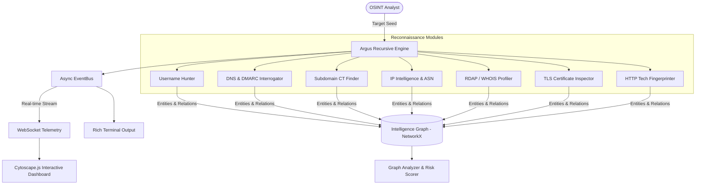
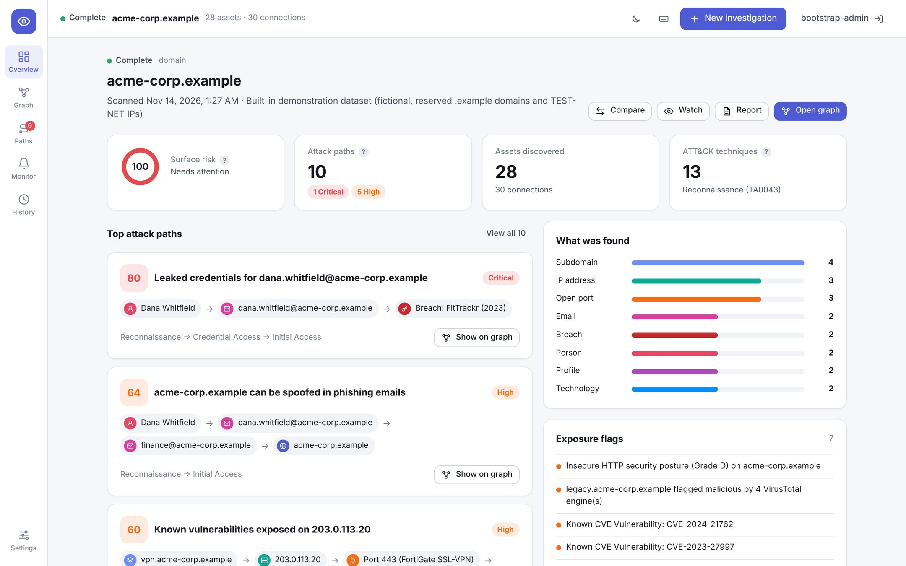
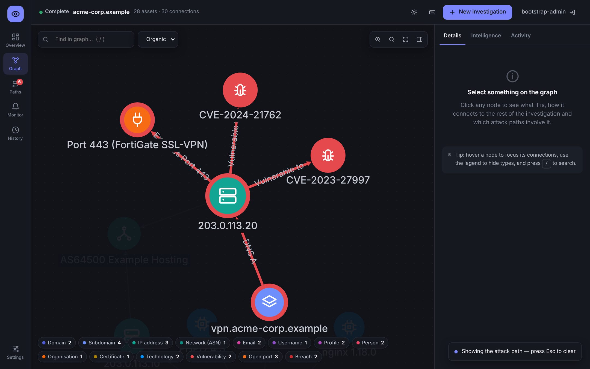

# 👁️ Argus: Autonomous OSINT Reconnaissance & Graph Link Analysis

[](https://github.com/alanalbino2008/Argus/actions/workflows/ci.yml)
[](https://github.com/alanalbino2008/Argus/actions/workflows/codeql.yml)
[-brightgreen)](#-testing--verification)
[](https://www.python.org/)
[](https://docs.astral.sh/ruff/)
[](https://mypy-lang.org/)
[](https://fastapi.tiangolo.com/)
[](LICENSE)

> *"Named after Argus Panoptes, the hundred-eyed all-seeing giant of Greek mythology, Argus is a next-generation Open Source Intelligence (OSINT) platform that unites rapid credential hunting, multi-hop infrastructure enrichment, and interactive topological relationship graphing into a single, lightning-fast platform."*

---

## 🌟 Vision & Key Capabilities

Argus bridges the gap between fragmented CLI tools and expensive enterprise intelligence suites by fusing the best features of industry standards with modern web-scale engineering:

* ⚡ **Sherlock-Class Identity Hunting:** Asynchronous, concurrent account hunting across 120+ hand-checked platforms plus the community-maintained WhatsMyName catalog (hundreds more sites), with optional handle variants (jane.roe → jane_roe, janeroe…), with **self-calibration**: every hit is re-checked against a random, unregistered handle, so sites that answer "yes" to everything are discarded instead of producing false positives — then follows each account to learn more about the person behind it.
* 🕸️ **Spiderfoot-Style Recursive Infrastructure Mapping:** Automated multi-hop enrichment: Domain ➔ DNS ➔ IP ➔ GeoIP/ASN ➔ RDAP Registrant ➔ Subdomains via Certificate Transparency ➔ TLS SANs ➔ Web Tech Stack.
* 🔮 **Maltego-Grade Visual Link Analysis:** Interactive physics-driven graph visualization built on **Cytoscape.js** with real-time WebSocket telemetry streaming. Nodes and relationships animate live onto the canvas as intelligence is discovered.
* 🛡️ **Novel Innovation — Attack Surface Scoring & Pivot Analysis:** Topological analysis utilizing graph degree centrality to identify single-point-of-failure infrastructure hubs, detect missing defensive headers (HSTS, CSP), and calculate a quantitative exposure score.
* 🔄 **Enterprise Interoperability:** Export complete knowledge graphs to standardized JSON or **Maltego-compatible CSV format** with one click.

---

## 🏗️ System Architecture



### Reliability & Resilience Engineering

| Concern | How Argus handles it |
|---|---|
| **Throughput** | A pool of async workers (`concurrency_limit`) expands entities in parallel; every eligible module runs concurrently per entity. |
| **Slow / hung data sources** | Hard per-module wall-clock timeout (`module_timeout_seconds`). |
| **Transient failures** | Shared `HttpClient` retries 429/5xx and connection errors with exponential backoff + full jitter, honouring `Retry-After`. |
| **Being a good network citizen** | Per-host rate limiting and per-host concurrency caps; a 429 slows *all* callers for that host. |
| **Repeatedly broken modules** | Circuit breaker disables a module after N consecutive failures. |
| **Graph explosions** | `max_entities` safety cap with explicit `truncated` flag. |
| **Control** | Cooperative cancellation (`POST /api/investigation/{id}/cancel`) and explicit `completed` / `cancelled` / `failed` states. |
| **Observability** | Per-module stats (runs, failures, timeouts, latency) and HTTP stats (requests, retries, throttles, status codes) on every investigation. |
| **Corporate networks** | Honours `HTTP(S)_PROXY` / `NO_PROXY`. |

Plain-English walkthroughs: [engine & reliability](docs/explained/01-engine-and-reliability.md) · [persistence & history](docs/explained/02-persistence-and-history.md).

### Persistence & History

Every investigation is stored in a database (SQLite by default, PostgreSQL via `ARGUS_DATABASE_URL`), checkpointed every second while it runs, and survives restarts. The web UI's **History** tab reopens any past investigation, and the inspector shows every *other* investigation in which the same IP, email or domain appeared.

| Method & path | Purpose |
|---|---|
| `POST /api/scan` | Launch an investigation |
| `GET /api/investigations?status=&target=&limit=&offset=` | Investigation history |
| `GET /api/investigation/{id}` | Status, stats, errors and warnings |
| `POST /api/investigation/{id}/cancel` | Cancel a running scan |
| `DELETE /api/investigation/{id}` | Delete an investigation and its findings |
| `GET /api/investigation/{id}/graph` · `/export/json` · `/export/csv` | Graph and exports |
| `GET /api/entities/search?q=&type=` | Cross-investigation entity pivot |
| `GET /api/health` | Liveness/readiness probe (public) |
| `GET /api/me` · `POST /api/ws-ticket` | Current identity · one-time WebSocket ticket |
| `GET/POST /api/keys` · `DELETE /api/keys/{id}` | API-key management (admin) |
| `GET /api/audit` · `GET /api/audit/verify` | Audit trail and tamper check (admin) |
| `WS /ws/stream/{id}?ticket=` | Snapshot of findings so far, then live events |

| Setting (env var) | Default |
|---|---|
| `ARGUS_DATABASE_URL` | `sqlite+aiosqlite:///./argus.db` |
| `ARGUS_PERSIST_FLUSH_INTERVAL` | `1.0` seconds |
| `ARGUS_WS_QUEUE_SIZE` | `2000` messages per client |

---



### ⭐ Attack Path Engine — Argus's Signature Capability

Most OSINT tools return a list of findings. Argus **chains them into the attack scenarios an adversary would actually use** — *leaked password → corporate mailbox → credential stuffing*, *no DMARC + known staff → convincing phishing*, *public hostname → VPN appliance → known CVE* — ranks them by risk, maps each to its MITRE ATT&CK route (Reconnaissance → Initial Access) and gives prioritised fixes. Select a path and it lights up on the graph.



Try it without scanning anything: `python -m argus.cli.console --load-demo` loads a fictional company (reserved `.example` domains and TEST-NET IPs) that triggers every rule. How it works: [`docs/explained/06-attack-path-engine.md`](docs/explained/06-attack-path-engine.md).

### Deep Recon — finding what is hidden

Beyond live DNS and websites, Argus digs where organisations forget to look:

| Source | What it uncovers |
|---|---|
| **Internet Archive** | Forgotten sub-domains, once-public `.env`/`.git`/backup files, admin panels, API specs, documents, credentials in URLs (redacted) |
| **Document metadata** (FOCA technique) | Authors and *internal account names* (`jsmith`), software versions and company from public PDFs and Office files — read from the archive's copy, never the target |
| **Five passive-DNS datasets** | Sub-domains certificates never revealed (HackerTarget, AlienVault OTX, Anubis, CertSpotter, urlscan), each host tagged with which sources saw it |
| **GitHub** | The organisation (verified against the domain) and its public members' handles; public code mentioning the domain, scanned for leaked keys and passwords (stored only as a 4-character preview) |
| **PGP keyservers** | Real names and the other email addresses bound to the same key |
| **The website itself** *(active)* | `security.txt`, `robots.txt`, exposed `.git`/`.env`/`server-status` confirmed by content, published emails and phone numbers |
| **Cloud storage** *(active)* | Amazon S3 / Google Cloud buckets named after the organisation, and whether anyone can list them |

Findings seen by several independent sources gain confidence automatically (and show *who* saw them). Argus learns the organisation's **email format** (`first.last@`) and predicts — clearly marked as *inferred* — the work address of staff found without one. Four new attack paths turn this into risk: **leaked secrets in code**, **exposed sensitive files**, **public cloud storage** and **staff enumeration for password spraying**. Tick **Passive only** (or `--passive-only`) and nothing touches the target's own systems. See [`docs/explained/10-deep-recon.md`](docs/explained/10-deep-recon.md).

### People & Software Intelligence

A username or email is a starting point, not an answer. When Argus finds an account it reads the platform's **official public API** for what the owner chose to publish — display name, bio, location, employer, website, join date and *linked accounts* — and follows those links. **Identity resolution** then groups the fragments into **people**, each with a dossier: accounts, emails, handles, locations, employer, a timeline (joined GitHub 2014 → password exposed in a 2023 breach) and the exposures and attack paths they are part of. Every link is graded **verified** (proven by Keybase or Mastodon), **strong** or **possible** (same handle — may be someone else), shared inboxes like `info@` are never treated as people, viewing a dossier is audited, and the analyst's browser never loads remote avatars (Argus fetches and fingerprints them on its server), so the analyst's IP doesn't leak to the subject's platforms. The **same profile picture** on two sites links the accounts as a strong match.

Software gets the same treatment: `PHP/7.4.3` is checked against **endoflife.date** (*end-of-life since Nov 2022*), and every CVE against **CISA's Known Exploited Vulnerabilities** catalog, **FIRST EPSS** (probability of exploitation in the next 30 days) and **NIST NVD** (CVSS). A CVE that is being exploited in the wild raises its attack path to critical. See [`docs/explained/09-people-and-software-intelligence.md`](docs/explained/09-people-and-software-intelligence.md).

### Continuous Monitoring

Watch a target and Argus re-scans it on a schedule, compares each scan with the last and raises an **alert** when the attack surface changes materially — *"3 new attack paths, worst: Redis exposed to the internet; 1 path escalated; risk up +132"*. Compare any two scans to see exactly what appeared, what disappeared and which attack paths opened, escalated or were fixed. See [`docs/explained/07-continuous-monitoring.md`](docs/explained/07-continuous-monitoring.md).

### Intelligence Outputs

| Output | What it gives you |
|---|---|
| **MITRE ATT&CK mapping** | Findings classified by Reconnaissance (TA0043) technique, with defensive guidance; every module labelled active or passive |
| **ATT&CK Navigator layer** | Heat-map for MITRE's official [Navigator](https://mitre-attack.github.io/attack-navigator/) |
| **STIX 2.1 bundle** | Import into OpenCTI, MISP or any STIX platform (TLP:AMBER) |
| **Maltego CSV / JSON graph** | Link analysis in Maltego or your own tooling |

Optional modules unlock with an API key — `ARGUS_VIRUSTOTAL_API_KEY`, `ARGUS_HIBP_API_KEY`, `ARGUS_SHODAN_API_KEY`, `ARGUS_GITHUB_TOKEN` (public code-leak search) — and third-party plugins load only when allowlisted in `ARGUS_PLUGINS`. See [`docs/explained/05-intelligence-features.md`](docs/explained/05-intelligence-features.md).

### Security Model

Argus ingests attacker-controlled data and makes outbound connections on a user's behalf, so the platform itself is treated as attack surface.

| Control | Implementation |
|---|---|
| **Authentication** | API keys (`Authorization: Bearer`), 256-bit random, stored only as SHA-256 hashes; revocable |
| **Authorisation (RBAC)** | `viewer` (read) · `analyst` (+ scan/cancel) · `admin` (+ delete, keys, audit) |
| **Rules of engagement** | Every scan requires a stated purpose and explicit confirmation of authorisation |
| **SSRF / egress guard** | Private, loopback, link-local (cloud metadata), CGNAT and internal hostnames blocked at seed validation *and* at connection time after DNS resolution (defeats DNS rebinding); opt-in `ARGUS_ALLOW_PRIVATE_TARGETS` for authorised internal tests |
| **Audit trail** | Append-only, SHA-256 hash-chained log of scans, exports, deletions, key changes and denied requests; `GET /api/audit/verify` detects tampering |
| **Abuse limits** | Per-key scan rate limit and a server-wide concurrent scan cap (HTTP 429) |
| **Browser hardening** | Strict CSP (`script-src 'self'`), `frame-ancestors 'none'`, `nosniff`, `no-referrer`, `Cache-Control: no-store` on API data; HSTS over HTTPS; output escaping of all OSINT data |
| **CORS** | Same-origin by default; extra origins must be listed explicitly (`ARGUS_CORS_ORIGINS`) |
| **WebSockets** | Single-use, 30-second tickets instead of long-lived keys in URLs |

See [`docs/explained/03-platform-security.md`](docs/explained/03-platform-security.md) and [`SECURITY.md`](SECURITY.md).

| Security setting (env var) | Default |
|---|---|
| `ARGUS_AUTH_ENABLED` | `true` |
| `ARGUS_BOOTSTRAP_ADMIN_KEY` | *(unset → generated and logged once)* |
| `ARGUS_ALLOW_PRIVATE_TARGETS` | `false` |
| `ARGUS_CORS_ORIGINS` | `[]` |
| `ARGUS_MAX_CONCURRENT_SCANS` / `ARGUS_SCANS_PER_MINUTE` | `5` / `10` |

---

## 🚀 Quickstart & Installation

### Option 1: Local Python Environment (Recommended)

```bash
# 1. Clone repository
git clone https://github.com/alanalbino2008/Argus.git
cd Argus

# 2. Create and activate virtual environment
python -m venv venv
# On Windows:
.\venv\Scripts\activate
# On Linux/macOS:
source venv/bin/activate

# 3. Install dependencies
pip install -r requirements.txt
```

### Option 2: Docker (single node)

```bash
docker compose up -d        # SQLite on a volume; open http://localhost:8000
```

### Option 3: Clustered on PostgreSQL

```bash
cp deploy/compose/.env.example deploy/compose/.env    # set real secrets
docker compose -f deploy/compose/cluster.yml up -d --build
```

PostgreSQL, a one-off migration job, two Argus replicas and an nginx load balancer.

### Option 4: Kubernetes (Helm)

```bash
helm install argus deploy/helm/argus --namespace argus --create-namespace \
  --set externalDatabase.existingSecret=argus-db     # omit to try it with a bundled PostgreSQL
```

Highly available out of the box: several replicas spread across nodes and zones, rolling
updates with no downtime, a disruption budget, optional autoscaling, non-root read-only pods,
and network policies that let Argus reach the internet but never private ranges or the cloud
metadata endpoint. Replicas coordinate through PostgreSQL — scan ownership with heartbeats,
cancellation from any replica, live streaming of scans running elsewhere, shared WebSocket
tickets, exactly-once scheduling and a concurrency-safe audit chain — so no sticky sessions or
message broker are needed. Every push installs the chart on a real Kubernetes cluster in CI.
**Single sign-on**: people sign in with the organisation's identity provider — Google Workspace,
Microsoft Entra ID, Okta, Keycloak or any OpenID Connect provider — with roles mapped from its groups,
an email-domain allow-list, secure server-side sessions and user management; API keys remain for
automation ([`docs/explained/13-single-sign-on.md`](docs/explained/13-single-sign-on.md)).

**Team workspaces**: one deployment serves many teams with hard isolation. Each workspace has its
own investigations, monitors, alerts, API keys and audit trail. Roles are per workspace, membership
can be mapped from identity-provider groups, and every endpoint is tested to return 404 for another
workspace's data ([`docs/explained/14-team-workspaces.md`](docs/explained/14-team-workspaces.md)).

**Outbound alerts**: drift alerts reach people where they work: Slack, Microsoft Teams, email,
or signed webhooks (Standard Webhooks, HMAC-SHA256 with replay protection and zero-downtime secret
rotation) for a SIEM or SOAR. A transactional outbox means no alert is lost, deliveries are retried
with backoff for about 7 hours, and replicas share the work without duplicates. Destination URLs
are SSRF-guarded and encrypted at rest with AES-256-GCM
([`docs/explained/15-outbound-alerts.md`](docs/explained/15-outbound-alerts.md)).

**Client reports**: a branded PDF for any investigation, with an executive summary and risk
gauge, prioritised recommendations, attack paths with MITRE ATT&CK and remediation, inventory
and methodology. It's classified with FIRST TLP 2.0 on every page, and personal data is
pseudonymised by default. Every report's SHA-256 fingerprint is registered, so recipients can
verify a copy is genuine and unmodified, even without an account
([`docs/explained/16-client-reports.md`](docs/explained/16-client-reports.md)).

**Scheduled reports**: "every Monday at 08:00 Europe/London" sends the latest scan's PDF by
email (attached) and a summary to Slack, Teams or a SIEM. Schedules are DST-correct, sent once
across replicas, skip unchanged targets, and are always pseudonymised
([`docs/explained/17-scheduled-reports.md`](docs/explained/17-scheduled-reports.md)).

**Guided first scan**: a four-step wizard teaches responsible reconnaissance before anything is
scanned:
- authorisation and good first targets;
- a server-side pre-flight check with legal and ethical warnings (government and NHS domains,
  large companies outside bug bounty scope, personal data under UK GDPR), recorded in the audit
  log;
- passive vs active reconnaissance;
- live, plain-English progress ending in "what an attacker could learn".

A getting-started checklist tracks the whole workflow
([`docs/explained/18-guided-first-scan.md`](docs/explained/18-guided-first-scan.md)).

**Brand impersonation (digital risk protection)**: Argus generates the domains an attacker
would register to impersonate the target (combosquats like `acme-login.com`, homoglyphs, IDN
homographs such as a Cyrillic `аcme.com`, other endings, typos, bitsquats) and finds which
exist using passive DNS only. It calibrates against wildcard TLDs, recognises your own defensive
registrations, and flags email-capable impostors as attack paths (T1583.001 → T1566). A newly
registered impostor triggers a monitoring alert. Lookalikes are out of scope by construction:
the engine never investigates a third party's domain
([`docs/explained/19-brand-impersonation.md`](docs/explained/19-brand-impersonation.md)).

**Infrastructure pivoting**: from one domain to the rest of the organisation's estate.

- Pivots, all passive: shared analytics, ad and tag IDs (from the archived homepage), the
  certificate organisation on OV/EV certificates, dedicated name servers, and co-hosting.
- Each related domain gets a probabilistic confidence (weighted noisy-OR, with generic
  infrastructure excluded), and the shared things appear as graph nodes.
- Related domains are recorded out of scope until someone authorises them.
- Impostors on the same server are mapped into one attacker-campaign finding.

([`docs/explained/20-infrastructure-pivoting.md`](docs/explained/20-infrastructure-pivoting.md)).

**Security rating**: a transparent A–F grade from eight weighted factors (patching, leaks,
network, web and TLS, email, brand, DNS, social engineering).

- Every point lost is a finding with its fix.
- Critical issues cap the grade.
- Unassessed factors lower the rating's confidence rather than counting as perfect.
- A "fastest route to the next grade" shows what to fix first.
- Ratings are tracked over time, and a **Ratings** portfolio page benchmarks each organisation
  against the others assessed in the workspace, never against invented industry averages.
- The rating is included in PDF reports.

([`docs/explained/21-security-rating.md`](docs/explained/21-security-rating.md), which is also the published
methodology).

**Supplier risk**: a supplier register (add suppliers or import your spreadsheet) where every
third party is assessed **passively** and continuously, on a schedule set by its criticality
tier.

- Each supplier is rated, checked against a policy (critical suppliers must hold a B, for
  example) and placed on a criticality × grade **risk matrix**.
- An alert fires when a supplier's grade drops or breaches its policy.
- The register exports for compliance records such as DORA's register of information.

([`docs/explained/22-supplier-risk.md`](docs/explained/22-supplier-risk.md)).

**Breach & dark-web exposure**: daily checks of your domains for staff credentials in
**infostealer logs**, staff accounts in **breaches**, breaches of the organisation, and
**ransomware leak-site posts**, and the same checks for every supplier in the register.

- Alerts start with a baseline, then announce every new finding.
- Findings carry remediation advice and can be triaged and exported for password resets.
- Only metadata is collected, through legitimate sources (Have I Been Pwned for verified domains,
  the ransomware.live research feed).
- Staff addresses are masked unless an analyst reveals them, which is audited
  ([`docs/explained/24-breach-and-dark-web-exposure.md`](docs/explained/24-breach-and-dark-web-exposure.md)).

**Remediation workflow**: every finding (attack path, exposure, supplier) can become a task with
an owner, a deadline from the workspace's severity policy, and a timeline.

- Fixes are **verified by evidence**: the next comparable scan (as deep, no more passive,
  complete) confirms a path is gone, and reopens the task if it comes back.
- Risk acceptances expire, and overdue tasks alert once.
- The page reports SLA compliance and median time to verified fix
  ([`docs/explained/25-remediation-workflow.md`](docs/explained/25-remediation-workflow.md)).

**Executive dashboard & board report**: everything Argus knows, summarised as a board asks.

- Five areas (attack surface, remediation, exposure, suppliers, threats) as red, amber or green,
  each with the reason.
- Key messages, worst first and including good news.
- The risks to act on, with owners and deadlines.
- A two-page, fingerprinted **board report** PDF, which can be emailed monthly
  ([`docs/explained/26-executive-dashboard.md`](docs/explained/26-executive-dashboard.md)).

**Cases & evidence capture** (for journalists, investigators and researchers): a case holds the
people, accounts and addresses involved, how they connect (with how sure you are), a timeline,
notes and scans. Restricted cases are invisible even to administrators.

- Web pages are preserved by Argus's server, which keeps the investigator hidden: the response, a
  full-page screenshot, the rendered page and the text.
- Each capture is fingerprinted, optionally given a trusted RFC 3161 timestamp, and tracked with a
  hash-chained chain of custody.
- Cases export as an evidence bundle anyone can verify
  ([`docs/explained/28-cases-and-evidence.md`](docs/explained/28-cases-and-evidence.md)).

**People and account investigation**:

- Usernames are searched across 120+ hand-checked sites and the community **WhatsMyName** catalog
  (hundreds more), every hit double-checked against a made-up name; optionally also likely
  **variations** of the handle, marked as leads only.
- Accounts on different sites with the **same profile picture** are linked to one person.
- **Watched accounts**: a case re-reads a subject's accounts on a schedule and records every change
  (name, bio, location, links, picture, or the account disappearing) on its timeline, capturing
  the profile as evidence each time
  ([`docs/explained/30-people-and-accounts.md`](docs/explained/30-people-and-accounts.md)).

**Images and documents**: **Inspect** any photo, PDF or Word, Excel or PowerPoint file in a case.

- Hidden details: camera and serial number, when and where a photo was taken (with a map link),
  authors and editors, company, software, comments, tracked changes, user names in file paths.
- Signs of editing and disguise: editing software, re-saves, a camera preview that shows a
  different picture, a file whose real type differs from its name, AI-generator settings and
  labels, Content Credentials, PDF JavaScript and attachments.
- **Check the shadows**: where the sun was at that place and time; **error level analysis**;
  reverse image search links; a **copy without metadata** for publishing safely
  ([`docs/explained/31-images-and-documents.md`](docs/explained/31-images-and-documents.md)).

**Timeline and map**: each case has **Timeline** and **Map** views.

- **Timeline**: everything dated in the case (events, account changes, captures, uploads, linked
  scans and the dates inside photos), with an activity chart and filters. Exports to CSV.
- **Map**: places given coordinates (decimal, degrees-minutes-seconds or a map link), photos' GPS,
  and addresses looked up on request. Exports to KML for Google Earth.
- Map images are fetched by Argus's server, never by your browser, so the map provider never sees
  which streets you are looking at
  ([`docs/explained/32-timeline-and-map.md`](docs/explained/32-timeline-and-map.md)).

**Crypto investigations**: give Argus a Bitcoin or Ethereum-style wallet address (or let it find
the addresses published on a website) and it follows the money.

- Balance, totals and active dates; who paid the wallet and whom it paid, with amounts.
- Addresses that share an owner (spent together), with CoinJoins detected and excluded.
- Exchange and service labels.
- A check of every wallet and counterparty against the **US Treasury's sanctions list**.
- Every address's checksum is verified, so mistyped or invented addresses are refused. Free public
  data, no API keys
  ([`docs/explained/34-crypto-investigations.md`](docs/explained/34-crypto-investigations.md)).

**Companies, sanctions and leaks**: investigate a company or a person by name.

- **UK Companies House**: directors, the people who really control a company, and every other
  company each director runs.
- **The global LEI register**: legal identity and parent companies up to the ultimate owner.
- **SEC filings** for US-listed companies.
- **US, UK and UN sanctions lists**, matched by name with a score. Argus points out when the date
  of birth or nationality shows it is probably a different person.
- **ICIJ Offshore Leaks** (Panama, Paradise and Pandora Papers).
- Premium sources come through **Argus Connect**: no keys needed, paid for in **Argus credits**
  ([`docs/explained/35-companies-sanctions-and-credits.md`](docs/explained/35-companies-sanctions-and-credits.md)).

**The AI analyst**: Claude reads a case and helps the investigator think.

- **Brief me**: what the case shows, what is missing, and the next steps worth taking.
- **Find names & dates** in the evidence (pages, PDFs, text files), each checked against the exact
  words it came from. You choose what to add.
- **Draft a report**, citing its sources, to edit.
- Nothing is sent without your confirmation, children are never profiled, and each document sent
  is recorded in its chain of custody. Use your own Claude key, or Argus credits
  ([`docs/explained/36-the-ai-analyst.md`](docs/explained/36-the-ai-analyst.md)).

**Playbooks**: the standard steps of an investigation, run for you in order, inside a case.

- Seven playbooks: company due diligence, person background, online identity, email footprint,
  crypto trail, website background and phone number.
- Each one scans, preserves the pages that matter as evidence, writes down what stands out (most
  serious first), and can end with an AI briefing.
- Runs follow the case's safety settings, are recorded in the audit log, and can be followed live
  or stopped
  ([`docs/explained/37-playbooks.md`](docs/explained/37-playbooks.md)).

**Website crawling**: Argus reads a whole website, not just its home page.

- It lists the email addresses, phone numbers, crypto wallets, social media accounts, documents
  and analytics IDs the site publishes, and the page each was found on.
- Documents are opened to read their hidden author.
- It obeys robots.txt, stays on the site, paces itself, and never visits the other sites it
  links to
  ([`docs/explained/38-website-crawling.md`](docs/explained/38-website-crawling.md)).

**Phone footprint**: what a phone number says about itself, and where it has been published.

- Every country, offline: whether the number is real, the country and area, and the line type
  (mobile, landline, VoIP, premium-rate…). VoIP lines, often used to hide who is behind a number,
  are flagged.
- Web mentions of a number or email address, each checked to really contain it. Reports on
  nuisance-call sites and paste sites come first. Use your own search key, or Argus credits
  ([`docs/explained/39-phone-footprint.md`](docs/explained/39-phone-footprint.md)).

**Network ranges**: who owns the addresses behind a target, and every other range they run.

- For an address: its block, who it is registered to, and the network announcing it. Cloud and
  hosting addresses are marked as shared.
- For a company: the networks registered in its name and every address range they announce.
- From the public registries only: listed, never scanned
  ([`docs/explained/40-network-ranges.md`](docs/explained/40-network-ranges.md)).

**The case vault**: a lost or seized laptop doesn't expose sources.

- Cases, evidence and scan results are encrypted on the investigator's computer with their own
  passphrase (AES-256-GCM, with a key derived using scrypt), plus a one-time recovery code.
- It locks itself when idle, and unlocks in the browser.
- No readable copies are left on disk: a test reads the raw database files to prove it
  ([`docs/explained/41-case-vault.md`](docs/explained/41-case-vault.md)).

**Bigger username search, with same-person checks**

- A username is checked on thousands of sites from two community lists, each checked once and
  calibrated against a made-up name.
- Accounts' public profiles (name, photo, bio, place, links) are compared. Argus says which
  accounts are the same person, which are doubtful, and why
  ([`docs/explained/42-username-search.md`](docs/explained/42-username-search.md)).

**Relationship mapping and the link chart**: who is connected to whom, how, and how surely.

- Relationships have kinds (family, work, business and money, social, shared details), dates and
  evidence.
- Argus suggests relationships it finds in the case: company boards, shared phones and addresses,
  common employers, people named together.
- The link chart shows the network, its key people and go-betweens, its groups, and the chain
  between any two people. Children can be protected from all of it
  ([`docs/explained/43-relationship-mapping.md`](docs/explained/43-relationship-mapping.md)).

**Person profiles, filled from scans**

- The people and organisations a scan finds join the case automatically, with their
  relationships.
- Each person has a profile with everything the case knows about them: relationships, accounts,
  places, register records, sanctions checks, a timeline, and every note and document that names
  them
  ([`docs/explained/44-person-profiles.md`](docs/explained/44-person-profiles.md)).

**Argus Personal and Argus accounts** (subscription-ready): Argus can run on an investigator's own
laptop (`argus --personal`), with cases kept on that computer.

- It is unlocked by an **Argus account**, created and checked by an account service you run
  centrally. The service issues a signed licence per computer.
- The licence is checked offline (it can't be forged or edited), renews itself in the background,
  and keeps working offline for two weeks.
- Plans, trials, a two-computer limit and subscription status are built in, ready for a payment
  provider.
- If a subscription lapses, cases stay readable, verifiable and exportable; only new work waits
  ([`docs/explained/33-accounts-and-argus-personal.md`](docs/explained/33-accounts-and-argus-personal.md)).

**Investigator safety**: the people you investigate can see every visit in their logs.

- Captures and scans can go out through **Tor, a VPN or a proxy**, chosen per case, per capture
  or per scan; a one-click test shows the address sites see and catches leaks.
- **Anonymous cases** never touch their subjects directly: direct captures are refused and scans
  are passive and routed.
- Argus presents an ordinary browser, never its own name
  ([`docs/explained/29-investigator-safety.md`](docs/explained/29-investigator-safety.md)).

**Compliance mapping**: Argus's evidence mapped to **Cyber Essentials, ISO/IEC 27001:2022, NIST
CSF 2.0 and DORA**.

- Each control is met, partially met, a gap, or not assessed. Each status shows its reasons, its
  evidence and the findings behind it, which can be tracked as fixes.
- Coverage is labelled honestly (outside-in evidence can't prove everything), and no evidence is
  never treated as a pass.
- Exports: a CSV per framework and a JSON evidence pack for auditors and GRC tools
  ([`docs/explained/27-compliance-mapping.md`](docs/explained/27-compliance-mapping.md)).

**API & integrations**: a documented REST API (OpenAPI 3.1 at `/docs`, with authentication,
workspace header and required role on every operation), per-key rate limits with `RateLimit-*`
headers, and an official Python client (`clients/python`).

- Alerts open **Jira** issues or **ServiceNow** incidents, exactly one per alert even when a
  delivery is retried.
- Alerts and reports stream into **Splunk** or **Microsoft Sentinel**.
- Credentials are write-only and encrypted.
- Self-hosted systems on private networks are reachable only when the operator allowlists them.

([`docs/API.md`](docs/API.md) · [`docs/explained/23-api-and-integrations.md`](docs/explained/23-api-and-integrations.md)).

**Observability**: every replica exports Prometheus metrics (API, scans, collectors, OSINT sources,
SSRF blocks, auth failures) with bounded labels, writes JSON logs correlated by `request_id` and
`investigation_id`, and ships 14 unit-tested alert rules with runbooks and a Grafana dashboard —
as a ServiceMonitor, PrometheusRule and dashboard ConfigMap on Kubernetes, or a Prometheus + Grafana
overlay for Docker Compose ([`docs/explained/12-observability.md`](docs/explained/12-observability.md)).
Operator guide: [`docs/DEPLOYMENT.md`](docs/DEPLOYMENT.md) · How it works:
[`docs/explained/11-kubernetes-and-postgresql.md`](docs/explained/11-kubernetes-and-postgresql.md).

---

## 💻 Usage

### 1. Interactive Web Dashboard (Maltego in the Browser)

Launch the web platform and API server:

```bash
python -m argus.cli.console --serve
```

Then visit **`http://127.0.0.1:8000`** in your browser.

> **First start:** Argus is secure by default. If no admin key exists, one is generated and printed **once** in the server log — paste it into the sign-in screen, then create personal keys (`POST /api/keys`) and revoke the bootstrap key. Lost every admin key? `python -m argus.cli.console --create-api-key recovery --role admin`.

* Enter any target (**Domain**, **Username**, **Email**, or **IP Address**).
* Choose maximum hop depth (1 to 3).
* Click **Launch Recon**, state the engagement purpose and confirm you are authorised (recorded in the audit log), then watch the directed graph expand and animate in real time!
* Click any node to open the **Entity Inspector** and inspect confidence ratings, discovery origins, and enriched metadata.
* Switch to **Threat Intel** to view graph pivots, risk exposure score, and export to JSON or Maltego CSV.

---

### 2. High-Speed Terminal CLI

Argus includes a **Rich** command-line interface with automatic entity type detection, progress bars, and formatted tables:

```bash
# Scan a domain (Recursion Depth: 1)
python -m argus.cli.console example.com -d 1

# Sherlock-style username hunting across hundreds of platforms (self-calibrating)
python -m argus.cli.console torvalds -t username

# Scan an IP address with JSON export
python -m argus.cli.console 1.1.1.1 --export-json ip_report.json

# Investigate an email address and export Maltego CSV
python -m argus.cli.console security@example.com --export-csv maltego_export.csv
```

---

## 🔍 Module Breakdown

| Module | Primary Input | Discoveries & Enriched Entities | Technique / Protocol |
| :--- | :--- | :--- | :--- |
| **`username_hunter`** | `USERNAME` | `SOCIAL_PROFILE`, `HAS_ACCOUNT` | Concurrent async HTTP probes with false-positive heuristics |
| **`github_hunter`** | `USERNAME` | `PERSON`, `EMAIL` (commits), `ORGANIZATION`, `DOMAIN` | Mines public events, unmasks commit emails, queries keys |
| **`phone_recon`** | `PHONE` | `ORGANIZATION` (Carrier/Region), `LOCATED_IN` | International E.164 parsing, dial codes, telecom carrier mapping |
| **`shodan_internetdb`** | `IP_ADDRESS` | `PORT`, `VULNERABILITY` (CVEs), `DOMAIN` (Hostnames) | Passive Shodan exposure API querying open ports and known CVEs |
| **`dns_recon`** | `DOMAIN`, `SUBDOMAIN` | `IP_ADDRESS`, `DOMAIN` (MX/NS), `DNS_RECORD` (SPF/DMARC) | Asynchronous DNS resolution via `dnspython` |
| **`subdomain_finder`** | `DOMAIN` | `SUBDOMAIN`, `SUBDOMAIN_OF` | Passive Certificate Transparency log indexing (`crt.sh`) |
| **`passive_dns`** | `DOMAIN` | `SUBDOMAIN` (with per-source provenance) | HackerTarget, AlienVault OTX, Anubis, CertSpotter, urlscan.io |
| **`wayback`** | `DOMAIN` | `SUBDOMAIN`, `URL` (sensitive files, admin panels, APIs, documents) | Internet Archive CDX API |
| **`document_metadata`** | `URL` (documents) | `PERSON`, `USERNAME`, `TECHNOLOGY`, `ORGANIZATION` | OOXML/ODF/PDF metadata from the archived copy (defusedxml, zip-bomb guards) |
| **`github_org`** | `DOMAIN` | GitHub organisation, member `USERNAME`s | GitHub REST API; org must point back to the domain |
| **`code_leaks`** *(key)* | `DOMAIN` | `URL` (with redacted secrets), `SUBDOMAIN`, `EMAIL` | GitHub code search + secret patterns |
| **`pgp_keyserver`** | `EMAIL`, `DOMAIN` | `PERSON`, linked `EMAIL`s | HKP machine-readable index (keyserver.ubuntu.com) |
| **`web_recon`** *(active)* | `DOMAIN`, `SUBDOMAIN` | `URL` (exposed files), `EMAIL`, `PHONE` | security.txt, robots.txt, content-verified exposure checks |
| **`cloud_storage`** *(active)* | `DOMAIN` | `URL` (buckets) | S3 / GCS name probing and public-listing check |
| **`ip_intelligence`** | `IP_ADDRESS` | `ASN`, `ORGANIZATION`, `DOMAIN` (PTR) | Reverse DNS + BGP autonomous system & GeoIP resolution |
| **`whois_lookup`** | `DOMAIN` | `ORGANIZATION` (Registrar/Registrant), `EMAIL` (Abuse) | RFC 7480 RDAP protocol queries |
| **`tls_analyzer`** | `DOMAIN`, `SUBDOMAIN` | `CERTIFICATE`, `SUBDOMAIN` (via SANs) | TLS handshake on 443, certificate chain extraction |
| **`http_fingerprint`** | `DOMAIN`, `IP_ADDRESS` | `TECHNOLOGY` (Web Server, CDN, Framework) | Header analysis, HSTS/CSP defense audit & letter grade (A+ to F) |
| **`email_recon`** | `EMAIL` | `USERNAME`, `DOMAIN`, `SOCIAL_PROFILE` | RFC email parsing, disposable domain check, Gravatar profiling; role inboxes (`info@`) are not hunted |
| **`profile_enricher`** | `SOCIAL_PROFILE` | `PERSON`, `LOCATION`, `ORGANIZATION`, `DOMAIN`, `EMAIL`, linked `SOCIAL_PROFILE`/`USERNAME` | Official public APIs of GitLab, Reddit, Hacker News, Keybase (verified proofs), Dev.to, Mastodon (`rel="me"` verified links), Docker Hub, Bluesky |
| **`software_intel`** | `TECHNOLOGY`, `PORT`, `VULNERABILITY` | Enriches with lifecycle and CVE intel | endoflife.date, CISA KEV, FIRST EPSS, NIST NVD (rate-limited) |

---

## 🧪 Testing & Verification

Every push runs the full pipeline in GitHub Actions:

| Stage | What it proves |
|---|---|
| **Lint** — ruff (incl. bandit security rules) + format check | Style, likely bugs, security smells (`S` rules), asyncio pitfalls |
| **Types** — mypy (pydantic plugin) | Interfaces between engine, modules, storage and API agree |
| **Tests** — pytest on Python 3.10–3.13, coverage gate 85 % | ~150 tests: engine concurrency, retries, SSRF guard, auth/RBAC, audit tampering, persistence, migrations, and every collector's parsing against recorded API responses — all offline |
| **Package** — build wheel, install into an *empty* virtualenv, boot server | No undeclared dependencies or missing package data |
| **Dependency audit** — pip-audit | No known CVEs in dependencies |
| **Docker** — build, run, wait for `healthy`, check image contents | Image works and contains no source tree, `.git` or `.env` |
| **CodeQL** (weekly + every PR) | Static security analysis of Python and JavaScript |

Run the same checks locally:

```bash
pip install -r requirements-dev.txt
ruff check argus tests && ruff format --check argus tests && mypy argus
pytest --cov=argus
```

See [`CONTRIBUTING.md`](CONTRIBUTING.md) for the development workflow and [`docs/explained/04-engineering-quality.md`](docs/explained/04-engineering-quality.md) for the reasoning.

---

## 🎯 Academic & Professional Portfolio Context

This project was built from the ground up as a practical portfolio project to demonstrate readiness for:
* **BSc (Hons) Ethical Hacking at Abertay University** (Demonstrating network protocol comprehension, passive reconnaissance principles, and defensive engineering).
* **Cyber Security Degree Apprenticeship at Amazon** (Demonstrating Amazon Leadership Principles: *Dive Deep*, *Customer Obsession*, *Ownership*, and scalable asynchronous system design).

For interview presentation notes and STAR-method responses, refer to [`PORTFOLIO_GUIDE.md`](./PORTFOLIO_GUIDE.md) and [`ARCHITECTURE.md`](./ARCHITECTURE.md).

---

## ⚖️ Licence, Legal & Ethical Notice

**Copyright © 2025-2026 Alan Albino. All rights reserved.** Argus is proprietary software: no part of it may be copied, modified, distributed, used commercially or presented as anyone else's work without the copyright holder's prior written permission. Access to the source code (for example for academic or job applications) is for evaluation only and grants no licence. See [`LICENSE`](LICENSE).


Argus is developed strictly for authorized security research, educational exploration, threat intelligence, and defensive posture evaluation. All data collection mechanisms leverage publicly available endpoints, standard protocols (DNS, RDAP, HTTP), and public Certificate Transparency logs. Users are responsible for complying with all applicable local, national, and international laws.
