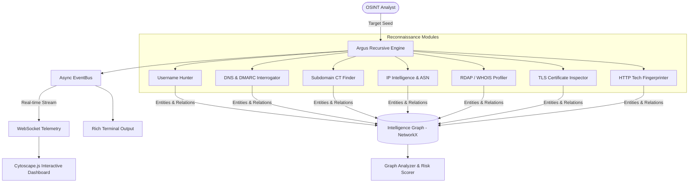
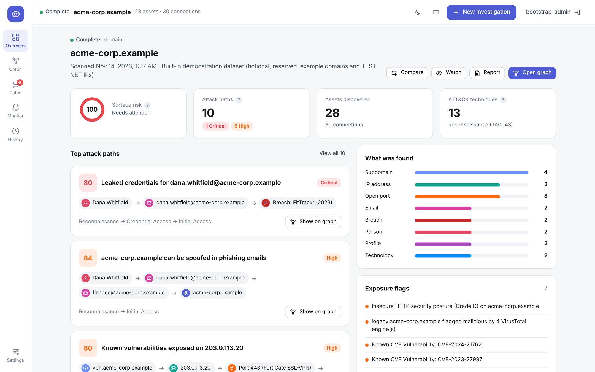
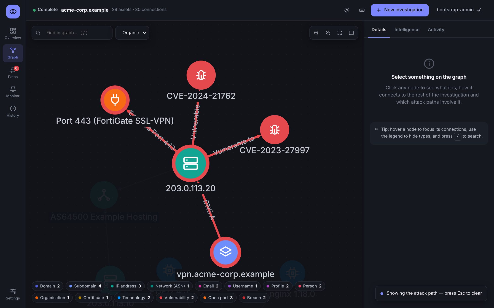

# 👁️ Argus: Autonomous OSINT Reconnaissance & Graph Link Analysis

[](https://github.com/alanalbino2008/Argus/actions/workflows/ci.yml)
[](https://github.com/alanalbino2008/Argus/actions/workflows/codeql.yml)
[-brightgreen)](#-testing--verification)
[](https://www.python.org/)
[](https://docs.astral.sh/ruff/)
[](https://mypy-lang.org/)
[](https://fastapi.tiangolo.com/)
[](LICENSE)

> *"Named after Argus Panoptes, the hundred-eyed all-seeing giant of Greek mythology, Argus is a next-generation Open Source Intelligence (OSINT) platform that unites rapid credential hunting, multi-hop infrastructure enrichment, and interactive topological relationship graphing into a single, lightning-fast platform."*

---

## 🌟 Vision & Key Capabilities

Argus bridges the gap between fragmented CLI tools and expensive enterprise intelligence suites by fusing the best features of industry standards with modern web-scale engineering:

* ⚡ **Sherlock-Class Identity Hunting:** Asynchronous, concurrent account hunting across 120+ platforms (developer, security, social, fediverse, creative, gaming…) with **self-calibration**: every hit is re-checked against a random, unregistered handle, so sites that answer "yes" to everything are discarded instead of producing false positives — then follows each account to learn more about the person behind it.
* 🕸️ **Spiderfoot-Style Recursive Infrastructure Mapping:** Automated multi-hop enrichment: Domain ➔ DNS ➔ IP ➔ GeoIP/ASN ➔ RDAP Registrant ➔ Subdomains via Certificate Transparency ➔ TLS SANs ➔ Web Tech Stack.
* 🔮 **Maltego-Grade Visual Link Analysis:** Interactive physics-driven graph visualization built on **Cytoscape.js** with real-time WebSocket telemetry streaming. Nodes and relationships animate live onto the canvas as intelligence is discovered.
* 🛡️ **Novel Innovation — Attack Surface Scoring & Pivot Analysis:** Topological analysis utilizing graph degree centrality to identify single-point-of-failure infrastructure hubs, detect missing defensive headers (HSTS, CSP), and calculate a quantitative exposure score.
* 🔄 **Enterprise Interoperability:** Export complete knowledge graphs to standardized JSON or **Maltego-compatible CSV format** with one click.

---

## 🏗️ System Architecture



### Reliability & Resilience Engineering

| Concern | How Argus handles it |
|---|---|
| **Throughput** | A pool of async workers (`concurrency_limit`) expands entities in parallel; every eligible module runs concurrently per entity. |
| **Slow / hung data sources** | Hard per-module wall-clock timeout (`module_timeout_seconds`). |
| **Transient failures** | Shared `HttpClient` retries 429/5xx and connection errors with exponential backoff + full jitter, honouring `Retry-After`. |
| **Being a good network citizen** | Per-host rate limiting and per-host concurrency caps; a 429 slows *all* callers for that host. |
| **Repeatedly broken modules** | Circuit breaker disables a module after N consecutive failures. |
| **Graph explosions** | `max_entities` safety cap with explicit `truncated` flag. |
| **Control** | Cooperative cancellation (`POST /api/investigation/{id}/cancel`) and explicit `completed` / `cancelled` / `failed` states. |
| **Observability** | Per-module stats (runs, failures, timeouts, latency) and HTTP stats (requests, retries, throttles, status codes) on every investigation. |
| **Corporate networks** | Honours `HTTP(S)_PROXY` / `NO_PROXY`. |

Plain-English walkthroughs: [engine & reliability](docs/explained/01-engine-and-reliability.md) · [persistence & history](docs/explained/02-persistence-and-history.md).

### Persistence & History

Every investigation is stored in a database (SQLite by default, PostgreSQL via `ARGUS_DATABASE_URL`), checkpointed every second while it runs, and survives restarts. The web UI's **History** tab reopens any past investigation, and the inspector shows every *other* investigation in which the same IP, email or domain appeared.

| Method & path | Purpose |
|---|---|
| `POST /api/scan` | Launch an investigation |
| `GET /api/investigations?status=&target=&limit=&offset=` | Investigation history |
| `GET /api/investigation/{id}` | Status, stats, errors and warnings |
| `POST /api/investigation/{id}/cancel` | Cancel a running scan |
| `DELETE /api/investigation/{id}` | Delete an investigation and its findings |
| `GET /api/investigation/{id}/graph` · `/export/json` · `/export/csv` | Graph and exports |
| `GET /api/entities/search?q=&type=` | Cross-investigation entity pivot |
| `GET /api/health` | Liveness/readiness probe (public) |
| `GET /api/me` · `POST /api/ws-ticket` | Current identity · one-time WebSocket ticket |
| `GET/POST /api/keys` · `DELETE /api/keys/{id}` | API-key management (admin) |
| `GET /api/audit` · `GET /api/audit/verify` | Audit trail and tamper check (admin) |
| `WS /ws/stream/{id}?ticket=` | Snapshot of findings so far, then live events |

| Setting (env var) | Default |
|---|---|
| `ARGUS_DATABASE_URL` | `sqlite+aiosqlite:///./argus.db` |
| `ARGUS_PERSIST_FLUSH_INTERVAL` | `1.0` seconds |
| `ARGUS_WS_QUEUE_SIZE` | `2000` messages per client |

---



### ⭐ Attack Path Engine — Argus's Signature Capability

Most OSINT tools return a list of findings. Argus **chains them into the attack scenarios an adversary would actually use** — *leaked password → corporate mailbox → credential stuffing*, *no DMARC + known staff → convincing phishing*, *public hostname → VPN appliance → known CVE* — ranks them by risk, maps each to its MITRE ATT&CK route (Reconnaissance → Initial Access) and gives prioritised fixes. Select a path and it lights up on the graph.



Try it without scanning anything: `python -m argus.cli.console --load-demo` loads a fictional company (reserved `.example` domains and TEST-NET IPs) that triggers every rule. How it works: [`docs/explained/06-attack-path-engine.md`](docs/explained/06-attack-path-engine.md).

### Deep Recon — finding what is hidden

Beyond live DNS and websites, Argus digs where organisations forget to look:

| Source | What it uncovers |
|---|---|
| **Internet Archive** | Forgotten sub-domains, once-public `.env`/`.git`/backup files, admin panels, API specs, documents, credentials in URLs (redacted) |
| **Document metadata** (FOCA technique) | Authors and *internal account names* (`jsmith`), software versions and company from public PDFs and Office files — read from the archive's copy, never the target |
| **Five passive-DNS datasets** | Sub-domains certificates never revealed (HackerTarget, AlienVault OTX, Anubis, CertSpotter, urlscan), each host tagged with which sources saw it |
| **GitHub** | The organisation (verified against the domain) and its public members' handles; public code mentioning the domain, scanned for leaked keys and passwords (stored only as a 4-character preview) |
| **PGP keyservers** | Real names and the other email addresses bound to the same key |
| **The website itself** *(active)* | `security.txt`, `robots.txt`, exposed `.git`/`.env`/`server-status` confirmed by content, published emails and phone numbers |
| **Cloud storage** *(active)* | Amazon S3 / Google Cloud buckets named after the organisation, and whether anyone can list them |

Findings seen by several independent sources gain confidence automatically (and show *who* saw them). Argus learns the organisation's **email format** (`first.last@`) and predicts — clearly marked as *inferred* — the work address of staff found without one. Four new attack paths turn this into risk: **leaked secrets in code**, **exposed sensitive files**, **public cloud storage** and **staff enumeration for password spraying**. Tick **Passive only** (or `--passive-only`) and nothing touches the target's own systems. See [`docs/explained/10-deep-recon.md`](docs/explained/10-deep-recon.md).

### People & Software Intelligence

A username or email is a starting point, not an answer. When Argus finds an account it reads the platform's **official public API** for what the owner chose to publish — display name, bio, location, employer, website, join date and *linked accounts* — and follows those links. **Identity resolution** then groups the fragments into **people**, each with a dossier: accounts, emails, handles, locations, employer, a timeline (joined GitHub 2014 → password exposed in a 2023 breach) and the exposures and attack paths they are part of. Every link is graded **verified** (proven by Keybase or Mastodon), **strong** or **possible** (same handle — may be someone else), shared inboxes like `info@` are never treated as people, viewing a dossier is audited, and remote avatars are never loaded, so the analyst's IP doesn't leak to the subject's platforms.

Software gets the same treatment: `PHP/7.4.3` is checked against **endoflife.date** (*end-of-life since Nov 2022*), and every CVE against **CISA's Known Exploited Vulnerabilities** catalog, **FIRST EPSS** (probability of exploitation in the next 30 days) and **NIST NVD** (CVSS). A CVE that is being exploited in the wild raises its attack path to critical. See [`docs/explained/09-people-and-software-intelligence.md`](docs/explained/09-people-and-software-intelligence.md).

### Continuous Monitoring

Watch a target and Argus re-scans it on a schedule, compares each scan with the last and raises an **alert** when the attack surface changes materially — *"3 new attack paths, worst: Redis exposed to the internet; 1 path escalated; risk up +132"*. Compare any two scans to see exactly what appeared, what disappeared and which attack paths opened, escalated or were fixed. See [`docs/explained/07-continuous-monitoring.md`](docs/explained/07-continuous-monitoring.md).

### Intelligence Outputs

| Output | What it gives you |
|---|---|
| **MITRE ATT&CK mapping** | Findings classified by Reconnaissance (TA0043) technique, with defensive guidance; every module labelled active or passive |
| **ATT&CK Navigator layer** | Heat-map for MITRE's official [Navigator](https://mitre-attack.github.io/attack-navigator/) |
| **STIX 2.1 bundle** | Import into OpenCTI, MISP or any STIX platform (TLP:AMBER) |
| **Maltego CSV / JSON graph** | Link analysis in Maltego or your own tooling |

Optional modules unlock with an API key — `ARGUS_VIRUSTOTAL_API_KEY`, `ARGUS_HIBP_API_KEY`, `ARGUS_SHODAN_API_KEY`, `ARGUS_GITHUB_TOKEN` (public code-leak search) — and third-party plugins load only when allowlisted in `ARGUS_PLUGINS`. See [`docs/explained/05-intelligence-features.md`](docs/explained/05-intelligence-features.md).

### Security Model

Argus ingests attacker-controlled data and makes outbound connections on a user's behalf, so the platform itself is treated as attack surface.

| Control | Implementation |
|---|---|
| **Authentication** | API keys (`Authorization: Bearer`), 256-bit random, stored only as SHA-256 hashes; revocable |
| **Authorisation (RBAC)** | `viewer` (read) · `analyst` (+ scan/cancel) · `admin` (+ delete, keys, audit) |
| **Rules of engagement** | Every scan requires a stated purpose and explicit confirmation of authorisation |
| **SSRF / egress guard** | Private, loopback, link-local (cloud metadata), CGNAT and internal hostnames blocked at seed validation *and* at connection time after DNS resolution (defeats DNS rebinding); opt-in `ARGUS_ALLOW_PRIVATE_TARGETS` for authorised internal tests |
| **Audit trail** | Append-only, SHA-256 hash-chained log of scans, exports, deletions, key changes and denied requests; `GET /api/audit/verify` detects tampering |
| **Abuse limits** | Per-key scan rate limit and a server-wide concurrent scan cap (HTTP 429) |
| **Browser hardening** | Strict CSP (`script-src 'self'`), `frame-ancestors 'none'`, `nosniff`, `no-referrer`, `Cache-Control: no-store` on API data; HSTS over HTTPS; output escaping of all OSINT data |
| **CORS** | Same-origin by default; extra origins must be listed explicitly (`ARGUS_CORS_ORIGINS`) |
| **WebSockets** | Single-use, 30-second tickets instead of long-lived keys in URLs |

See [`docs/explained/03-platform-security.md`](docs/explained/03-platform-security.md) and [`SECURITY.md`](SECURITY.md).

| Security setting (env var) | Default |
|---|---|
| `ARGUS_AUTH_ENABLED` | `true` |
| `ARGUS_BOOTSTRAP_ADMIN_KEY` | *(unset → generated and logged once)* |
| `ARGUS_ALLOW_PRIVATE_TARGETS` | `false` |
| `ARGUS_CORS_ORIGINS` | `[]` |
| `ARGUS_MAX_CONCURRENT_SCANS` / `ARGUS_SCANS_PER_MINUTE` | `5` / `10` |

---

## 🚀 Quickstart & Installation

### Option 1: Local Python Environment (Recommended)

```bash
# 1. Clone repository
git clone https://github.com/alanalbino2008/Argus.git
cd Argus

# 2. Create and activate virtual environment
python -m venv venv
# On Windows:
.\venv\Scripts\activate
# On Linux/macOS:
source venv/bin/activate

# 3. Install dependencies
pip install -r requirements.txt
```

### Option 2: Docker / Container Deployment

```bash
# Run one-command containerized stack
docker compose up -d

# Open http://localhost:8000 in your browser
```

---

## 💻 Usage

### 1. Interactive Web Dashboard (Maltego in the Browser)

Launch the web platform and API server:

```bash
python -m argus.cli.console --serve
```

Then visit **`http://127.0.0.1:8000`** in your browser.

> **First start:** Argus is secure by default. If no admin key exists, one is generated and printed **once** in the server log — paste it into the sign-in screen, then create personal keys (`POST /api/keys`) and revoke the bootstrap key. Lost every admin key? `python -m argus.cli.console --create-api-key recovery --role admin`.

* Enter any target (**Domain**, **Username**, **Email**, or **IP Address**).
* Choose maximum hop depth (1 to 3).
* Click **Launch Recon**, state the engagement purpose and confirm you are authorised (recorded in the audit log), then watch the directed graph expand and animate in real time!
* Click any node to open the **Entity Inspector** and inspect confidence ratings, discovery origins, and enriched metadata.
* Switch to **Threat Intel** to view graph pivots, risk exposure score, and export to JSON or Maltego CSV.

---

### 2. High-Speed Terminal CLI

Argus includes a **Rich** command-line interface with automatic entity type detection, progress bars, and formatted tables:

```bash
# Scan a domain (Recursion Depth: 1)
python -m argus.cli.console example.com -d 1

# Sherlock-style username hunting across 120+ platforms (self-calibrating)
python -m argus.cli.console torvalds -t username

# Scan an IP address with JSON export
python -m argus.cli.console 1.1.1.1 --export-json ip_report.json

# Investigate an email address and export Maltego CSV
python -m argus.cli.console security@example.com --export-csv maltego_export.csv
```

---

## 🔍 Module Breakdown

| Module | Primary Input | Discoveries & Enriched Entities | Technique / Protocol |
| :--- | :--- | :--- | :--- |
| **`username_hunter`** | `USERNAME` | `SOCIAL_PROFILE`, `HAS_ACCOUNT` | Concurrent async HTTP probes with false-positive heuristics |
| **`github_hunter`** | `USERNAME` | `PERSON`, `EMAIL` (commits), `ORGANIZATION`, `DOMAIN` | Mines public events, unmasks commit emails, queries keys |
| **`phone_recon`** | `PHONE` | `ORGANIZATION` (Carrier/Region), `LOCATED_IN` | International E.164 parsing, dial codes, telecom carrier mapping |
| **`shodan_internetdb`** | `IP_ADDRESS` | `PORT`, `VULNERABILITY` (CVEs), `DOMAIN` (Hostnames) | Passive Shodan exposure API querying open ports and known CVEs |
| **`dns_recon`** | `DOMAIN`, `SUBDOMAIN` | `IP_ADDRESS`, `DOMAIN` (MX/NS), `DNS_RECORD` (SPF/DMARC) | Asynchronous DNS resolution via `dnspython` |
| **`subdomain_finder`** | `DOMAIN` | `SUBDOMAIN`, `SUBDOMAIN_OF` | Passive Certificate Transparency log indexing (`crt.sh`) |
| **`passive_dns`** | `DOMAIN` | `SUBDOMAIN` (with per-source provenance) | HackerTarget, AlienVault OTX, Anubis, CertSpotter, urlscan.io |
| **`wayback`** | `DOMAIN` | `SUBDOMAIN`, `URL` (sensitive files, admin panels, APIs, documents) | Internet Archive CDX API |
| **`document_metadata`** | `URL` (documents) | `PERSON`, `USERNAME`, `TECHNOLOGY`, `ORGANIZATION` | OOXML/ODF/PDF metadata from the archived copy (defusedxml, zip-bomb guards) |
| **`github_org`** | `DOMAIN` | GitHub organisation, member `USERNAME`s | GitHub REST API; org must point back to the domain |
| **`code_leaks`** *(key)* | `DOMAIN` | `URL` (with redacted secrets), `SUBDOMAIN`, `EMAIL` | GitHub code search + secret patterns |
| **`pgp_keyserver`** | `EMAIL`, `DOMAIN` | `PERSON`, linked `EMAIL`s | HKP machine-readable index (keyserver.ubuntu.com) |
| **`web_recon`** *(active)* | `DOMAIN`, `SUBDOMAIN` | `URL` (exposed files), `EMAIL`, `PHONE` | security.txt, robots.txt, content-verified exposure checks |
| **`cloud_storage`** *(active)* | `DOMAIN` | `URL` (buckets) | S3 / GCS name probing and public-listing check |
| **`ip_intelligence`** | `IP_ADDRESS` | `ASN`, `ORGANIZATION`, `DOMAIN` (PTR) | Reverse DNS + BGP autonomous system & GeoIP resolution |
| **`whois_lookup`** | `DOMAIN` | `ORGANIZATION` (Registrar/Registrant), `EMAIL` (Abuse) | RFC 7480 RDAP protocol queries |
| **`tls_analyzer`** | `DOMAIN`, `SUBDOMAIN` | `CERTIFICATE`, `SUBDOMAIN` (via SANs) | TLS handshake on 443, certificate chain extraction |
| **`http_fingerprint`** | `DOMAIN`, `IP_ADDRESS` | `TECHNOLOGY` (Web Server, CDN, Framework) | Header analysis, HSTS/CSP defense audit & letter grade (A+ to F) |
| **`email_recon`** | `EMAIL` | `USERNAME`, `DOMAIN`, `SOCIAL_PROFILE` | RFC email parsing, disposable domain check, Gravatar profiling; role inboxes (`info@`) are not hunted |
| **`profile_enricher`** | `SOCIAL_PROFILE` | `PERSON`, `LOCATION`, `ORGANIZATION`, `DOMAIN`, `EMAIL`, linked `SOCIAL_PROFILE`/`USERNAME` | Official public APIs of GitLab, Reddit, Hacker News, Keybase (verified proofs), Dev.to, Mastodon (`rel="me"` verified links), Docker Hub, Bluesky |
| **`software_intel`** | `TECHNOLOGY`, `PORT`, `VULNERABILITY` | Enriches with lifecycle and CVE intel | endoflife.date, CISA KEV, FIRST EPSS, NIST NVD (rate-limited) |

---

## 🧪 Testing & Verification

Every push runs the full pipeline in GitHub Actions:

| Stage | What it proves |
|---|---|
| **Lint** — ruff (incl. bandit security rules) + format check | Style, likely bugs, security smells (`S` rules), asyncio pitfalls |
| **Types** — mypy (pydantic plugin) | Interfaces between engine, modules, storage and API agree |
| **Tests** — pytest on Python 3.10–3.13, coverage gate 85 % | ~150 tests: engine concurrency, retries, SSRF guard, auth/RBAC, audit tampering, persistence, migrations, and every collector's parsing against recorded API responses — all offline |
| **Package** — build wheel, install into an *empty* virtualenv, boot server | No undeclared dependencies or missing package data |
| **Dependency audit** — pip-audit | No known CVEs in dependencies |
| **Docker** — build, run, wait for `healthy`, check image contents | Image works and contains no source tree, `.git` or `.env` |
| **CodeQL** (weekly + every PR) | Static security analysis of Python and JavaScript |

Run the same checks locally:

```bash
pip install -r requirements-dev.txt
ruff check argus tests && ruff format --check argus tests && mypy argus
pytest --cov=argus
```

See [`CONTRIBUTING.md`](CONTRIBUTING.md) for the development workflow and [`docs/explained/04-engineering-quality.md`](docs/explained/04-engineering-quality.md) for the reasoning.

---

## 🎯 Academic & Professional Portfolio Context

This project was built from the ground up as a practical portfolio project to demonstrate readiness for:
* **BSc (Hons) Ethical Hacking at Abertay University** (Demonstrating network protocol comprehension, passive reconnaissance principles, and defensive engineering).
* **Cyber Security Degree Apprenticeship at Amazon** (Demonstrating Amazon Leadership Principles: *Dive Deep*, *Customer Obsession*, *Ownership*, and scalable asynchronous system design).

For interview presentation notes and STAR-method responses, refer to [`PORTFOLIO_GUIDE.md`](./PORTFOLIO_GUIDE.md) and [`ARCHITECTURE.md`](./ARCHITECTURE.md).

---

## ⚖️ Licence, Legal & Ethical Notice

**Copyright © 2025-2026 Alan Albino. All rights reserved.** Argus is proprietary software: no part of it may be copied, modified, distributed, used commercially or presented as anyone else's work without the copyright holder's prior written permission. Access to the source code (for example for academic or job applications) is for evaluation only and grants no licence. See [`LICENSE`](LICENSE).


Argus is developed strictly for authorized security research, educational exploration, threat intelligence, and defensive posture evaluation. All data collection mechanisms leverage publicly available endpoints, standard protocols (DNS, RDAP, HTTP), and public Certificate Transparency logs. Users are responsible for complying with all applicable local, national, and international laws.
